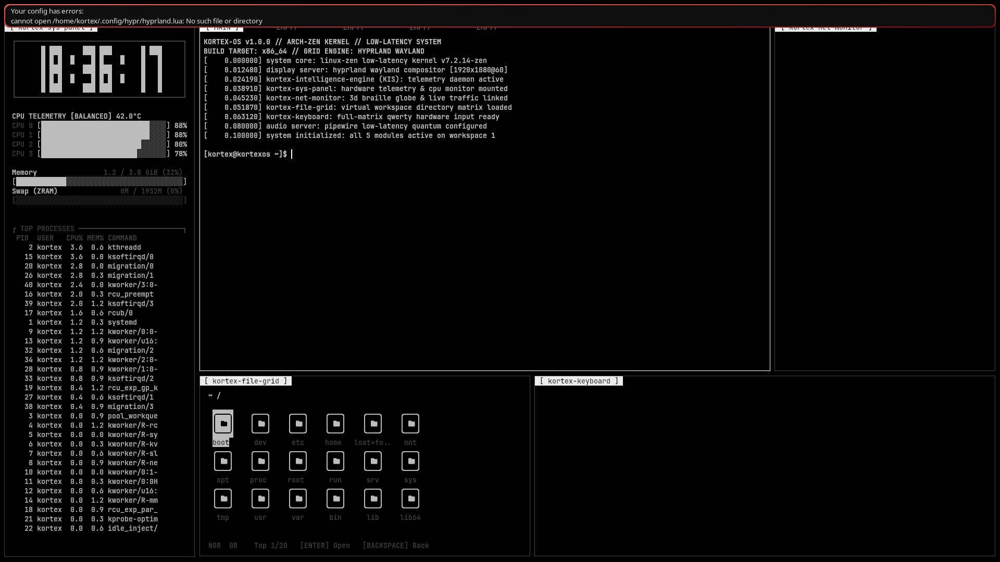
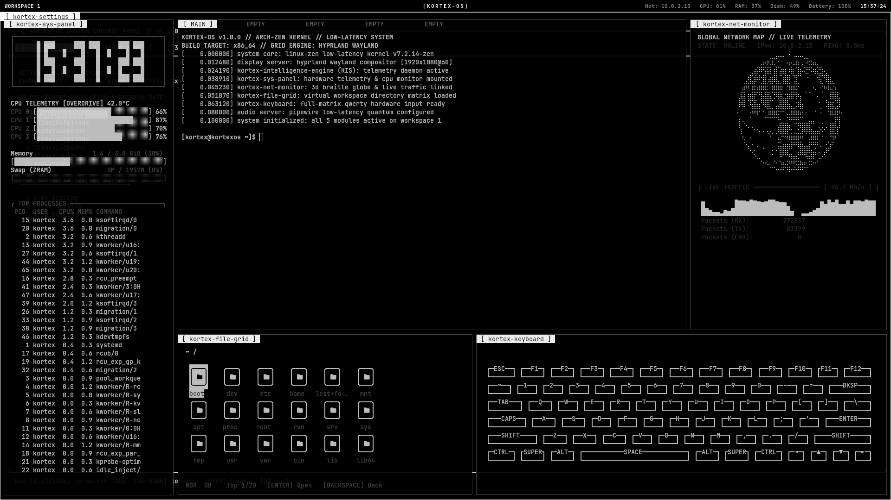

# KortexOS 🌌
### The High-Performance Cyberpunk & Glassmorphism Linux Operating System

[](https://github.com/ArtiomITPROGRAMING/KortexOS/releases)
[](https://archlinux.org)
[](https://github.com/zen-kernel/zen-kernel)
[](https://hyprland.org)
[](LICENSE)

[ 🇬🇧 Read in English ](README.md) | [ 🇷🇺 Читать на русском ](README.ru.md) | [ 🏪 App Catalog (Kortex Apps) ](https://github.com/ArtiomITPROGRAMING/kortex-apps)

---

## ⚡ Overview

**KortexOS** is an ultra-modern, rolling-release operating system built upon **Arch Linux**, the low-latency **Linux-Zen Kernel**, and the accelerated **Hyprland Wayland Compositor**. 

Designed for developers, gamers, cyber-security researchers, and everyday power users alike, KortexOS fuses the immersive aesthetics of a **cyberpunk cyber-deck** with the fluid, ergonomic polish of **macOS glassmorphism**.

```
       __ _____  ____ _____ _____ _  __  ____   _____
      / //_/ _ \/ __//_  _// __// // / / __ \ / ___/
     / ,< / // // _/   / / / _/ / _  / / /_/ /_\__ \ 
    /_/|_|\___//___/  /_/ /___//_//_/  \____//____/  
   >> UNIFIED DESIGN & PERSISTENCE ENGINE v1.0.0 <<
```

---

## 📸 Interface Gallery

| Cyber-Deck Grid (5 Panels) | Interactive Tour for Beginners |
| :---: | :---: |
|  |  |

| Kortex Theme Studio Pro | Kortex Music Player |
| :---: | :---: |
|  |  |

---

## 🧭 Three Unified Interface Philosophies

Switch between interface philosophies on the fly using **`Super + Tab`** or via the Waybar layout pill:

1. **Cyber-Deck (eDEX Grid)**: A 5-pane modular cockpit designed for multi-tasking (Live CPU/RAM pulse, Interactive command shell, 3D network telemetry, File Explorer, and Virtual keyboard).
2. **MacBook Pro Mode (Glass & Dock)**: Rounded frosted-glass windows with interactive mouse controls `[ _ ] [ □ ] [ X ]`, an island dock, and 3-finger touchpad gestures.
3. **Pure Tiling (Dev Mode)**: Fullscreen dynamic bsp/dwindle tiling with zero distractions and instant window cycling.

---

## 🚀 Quick Start for Beginners (Step-by-Step)

### Step 1: Download Stable Release
Download the pre-compiled live ISO image:
* 📥 **[Download KortexOS v1.0.0 ISO (~2.0 GB)](https://github.com/ArtiomITPROGRAMING/KortexOS/releases/download/v1.0.0/kortexos-v1.0.0-x86_64.iso)**
* 🔒 **[SHA-256 Checksums](https://github.com/ArtiomITPROGRAMING/KortexOS/releases/download/v1.0.0/SHA256SUMS.txt)**
* 🔒 **[SHA-512 Checksums](https://github.com/ArtiomITPROGRAMING/KortexOS/releases/download/v1.0.0/SHA512SUMS.txt)**

*(Verify integrity in terminal: `sha256sum -c SHA256SUMS.txt`)*

---

### Step 2: Flash to USB Drive

#### Option A: Using Rufus (Windows) — Easiest
1. Plug in a USB drive (4 GB minimum).
2. Open [Rufus](https://rufus.ie).
3. Select `kortexos-v1.0.0-x86_64.iso` and your USB drive.
4. Click **START**. When prompted, choose **Write in DD Image mode**.

#### Option B: Using Ventoy (Recommended for Multiboot)
1. Install [Ventoy](https://www.ventoy.net) on your USB stick.
2. Drag and drop `kortexos-v1.0.0-x86_64.iso` directly onto the USB drive. Done!

#### Option C: Flashing via `dd` (Linux/macOS)
```bash
sudo dd if=kortexos-v1.0.0-x86_64.iso of=/dev/sdX bs=4M status=progress oflag=sync
```
*(Replace `/dev/sdX` with your USB drive identifier, e.g. `/dev/sdb`).*

---

### Step 3: Boot & First Steps

1. Insert the USB flash drive and reboot your machine.
2. Press your boot menu key (**F12**, **F11**, **F8**, or **Esc** depending on motherboard).
3. Select the USB drive and press Enter.
4. Select **KortexOS Live (Default)** in the boot menu. The OS will boot into RAM without altering your hard drives.

#### New User Orientation:
* **Interactive Guided Tour (`kortex-tour`)**: Click the **`[ ? GUIDE ]`** button on the top-right bar or press **`Super + F1`**. It will highlight every feature, shortcut, and navigation button.
* **First-Run Wizard (`kortex-oobe`)**: Launch the setup wizard to select your language (`EN`, `RU`, `RO`, `DE`), connect to Wi-Fi/Bluetooth, and choose your favorite theme.

---

### Step 4: Install to Internal Disk (`kortex-install`)

KortexOS features **One-Click Live Persistence**: all customizations, themes, wallpapers, and settings configured during the Live session are automatically preserved and transferred to the installed disk!

1. Click **[ INSTALL TO DISK ]** on the desktop, dock, or run:
   ```bash
   kortex-install
   ```
2. Follow the on-screen installer: select your SSD/NVMe/HDD, set your username and password, and confirm.
3. Within minutes, KortexOS is permanently installed.

---

## 🏪 App Store & Catalog (Kortex App Hub)

KortexOS includes an integrated software manager backed by an open GitHub catalog:
* Launch via dock, application menu, or shortcut: `Super + P` / `kortex-store`.
* **Decentralized Catalog:** [ArtiomITPROGRAMING/kortex-apps](https://github.com/ArtiomITPROGRAMING/kortex-apps).
* Anyone can submit applications via Pull Requests, making apps instantly available to all KortexOS users worldwide.
* Supports native Arch packages, Flathub Flatpaks, and standalone bundles.

---

## 🎨 Theme Studio Pro (`kortex-settings`)

Press **`Super + S`** to open the customization studio:
- **Independent 7-layer HEX color engine**: Base, Surface, Primary Accent, Secondary Accent, Active Border, Inactive Border, Alerts.
- **7 Curated Palettes**: `Cyber Cyan`, `Tokyo Night`, `Dracula`, `Matrix Phosphor`, `Amber CRT`, `Mono Tron`, and `Crimson Alert`.
- **Border Geometry**: `Solid`, `Dual Gradient` (0–360°), `Animated Neon Loop`, and `Glow Shadow`.
- **Atomic Multi-Process Hot-Reload**: Hyprland, Waybar, Kitty, Rofi, and GTK-3/4 synchronized in under 3.5 seconds without rebooting.

---

## ⌨️ Hotkeys & Control Reference

| Shortcut | Action | Description |
| :--- | :--- | :--- |
| **`Super + Space`** | **Kortex Spotlight** | Instant app launcher, file search, and math calculator |
| **`Super + Tab`** | **Cycle Layouts** | Switch between Cyber-Deck ⇄ MacBook Glass ⇄ Pure Tiling |
| **`Super + Return`** | Terminal | Open high-performance Kitty terminal |
| **`Super + D`** | App Menu | Open full applications menu (Rofi) |
| **`Super + B`** | Web Browser | Launch Web Browser |
| **`Super + E`** | File Explorer | Open Yazi terminal file manager |
| **`Super + S`** | Settings | Kortex Theme Studio Pro & System Settings |
| **`Super + P`** | App Hub | Launch Kortex Software Store |
| **`Super + M`** | Music | Launch Kortex Music Player |
| **`Super + F1`** | **Guide / Help** | Launch Interactive Guided Tour & Keybinds Cheatsheet |
| **`Super + Q`** / **`Alt + F4`** | Close Window | Close current active window |
| **`Super + V`** | Toggle Floating | Toggle window between floating and tiled mode |
| **`Super + Shift + S`** | Screenshot | Capture area screenshot |
| **`Super + L`** | Lock Screen | Lock workstation screen |

*(Note: **`Super`** corresponds to the Windows / Command key on your keyboard).*

---

## 💻 Hardware Requirements

| Component | Minimum | Recommended |
| :--- | :--- | :--- |
| **CPU** | 64-bit x86-64 Dual-Core (1.8 GHz) | Quad-Core 2.5 GHz+ (Intel 8th+ Gen / AMD Ryzen) |
| **RAM** | 3.5 GB (with ZRAM compressed swap) | 8 GB+ DDR4 / DDR5 |
| **Storage** | 20 GB free disk space | 40 GB+ NVMe SSD |
| **GPU** | Intel HD Graphics / AMD Radeon / NVIDIA | Intel Iris Xe / AMD Radeon RDNA / modern GPU |
| **Display** | 1280 × 720 (720p) | 1920 × 1080 (1080p) or higher |

---

## ❓ Frequently Asked Questions (FAQ)

<details>
<summary><b>1. How do I switch keyboard layouts?</b></summary>
During first-run OOBE, select your hotkey (default is <code>Alt + Shift</code> or <code>Caps Lock</code>). You can also click the language badge on the top panel (<code>[ EN / RU ]</code>) to toggle instantly.
</details>

<details>
<summary><b>2. How do I change display scaling on High-DPI (2K/4K) screens?</b></summary>
Open Kortex Settings (<code>Super + S</code>), navigate to <b>Display</b>, and choose scaling <code>1.25</code>, <code>1.5</code>, or <code>2.0</code>.
</details>

<details>
<summary><b>3. How do I connect to Wi-Fi?</b></summary>
Click the Wi-Fi icon in the top right tray or run <code>nmtui</code> in the terminal.
</details>

<details>
<summary><b>4. Will my settings carry over to the installed system?</b></summary>
Yes! KortexOS automatically copies all Live session settings (wallpapers, themes, keyboard configurations) directly to the target installation.
</details>

---

## 🏗️ Building from Source

To build your own custom KortexOS ISO using Docker on Linux or WSL2:

```bash
# Clone the repository
git clone https://github.com/ArtiomITPROGRAMING/KortexOS.git
cd KortexOS

# Build privileged Docker ArchISO image
./build.sh

# The finished ISO will be created in:
ls -lh out/kortexos-latest.iso
```

---

## 📄 License

KortexOS is distributed under the terms of the **GNU General Public License v3.0 (GPL-3.0)**. See [LICENSE](LICENSE) for details.
