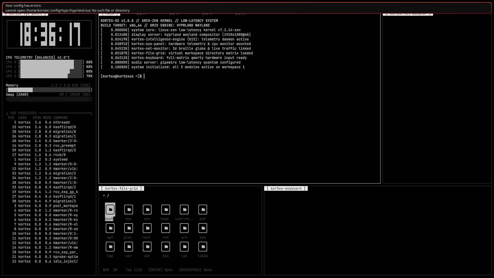
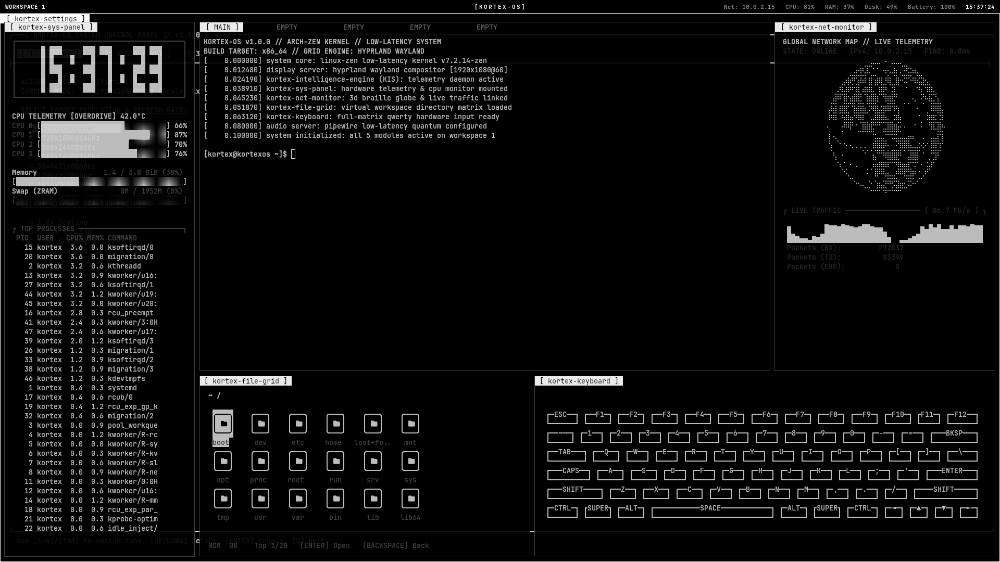

# KortexOS 🌌
### Высокопроизводительная операционная система в стиле Киберпанк и Glassmorphism (Arch Linux + Hyprland)

[](https://github.com/ArtiomITPROGRAMING/KortexOS/releases)
[](https://archlinux.org)
[](https://github.com/zen-kernel/zen-kernel)
[](https://hyprland.org)
[](LICENSE)

[ 🇬🇧 Read in English ](README.md) | [ 🇷🇺 Читать на русском ](README.ru.md) | [ 🏪 Магазин приложений (Kortex Apps) ](https://github.com/ArtiomITPROGRAMING/kortex-apps)

---

## ⚡ Что такое KortexOS?

**KortexOS** — это современная, быстрая и эстетичная операционная система на базе **Arch Linux**, игрового ядра с ультранизкими задержками **Linux-Zen** и графического окружения нового поколения **Hyprland (Wayland)**.

Она объединяет атмосферу киберпанк-терминала (**Cyber-Deck**) и плавную эргономику **macOS** (матовое стекло, плавающий док, управление окнами мышью и жесты тачпада). 

Система готова к использованию «из коробки» как для новичков, так и для разработчиков, геймеров и исследователей кибербезопасности.

```
       __ _____  ____ _____ _____ _  __  ____   _____
      / //_/ _ \/ __//_  _// __// // / / __ \ / ___/
     / ,< / // // _/   / / / _/ / _  / / /_/ /_\__ \ 
    /_/|_|\___//___/  /_/ /___//_//_/  \____//____/  
   >> UNIFIED DESIGN & PERSISTENCE ENGINE v1.0.0 <<
```

---

## 📸 Галерея интерфейса

| Cyber-Deck Grid (5 панелей) | Интерактивный гид для новичков |
| :---: | :---: |
|  |  |

| Студия кастомизации (Theme Studio) | Музыкальный плеер Kortex Music |
| :---: | :---: |
|  |  |

---

## 🧭 Три режима интерфейса (переключение в 1 клик)

Переключайтесь между режимами в любой момент через горячие клавиши **`Super + Tab`** или кликом по значку режима в верхней панели:

1. **Cyber-Deck (eDEX Grid)** — 5-модульная киберпанк-консоль (мониторинг процессора/памяти, терминал, 3D матрица сети, файловый менеджер и виртуальная клавиатура).
2. **MacBook Pro Mode (Glass & Dock)** — скругленные окна из матового стекла (эффект blur), кнопки мыши `[ _ ] [ □ ] [ X ]`, плавающий островной док и 3-пальцевые жесты тачпада.
3. **Pure Tiling (Dev Mode)** — классический динамический тайлинг Hyprland на весь экран без отвлекающих элементов для максимальной продуктивности.

---

## 🚀 Быстрый старт для новичков (Пошаговая инструкция)

### Шаг 1: Скачивание образа
Скачайте готовый стабильный образ с официальной страницы релизов:
* 📥 **[Скачать KortexOS v1.0.0 ISO (2.0 ГБ)](https://github.com/ArtiomITPROGRAMING/KortexOS/releases/download/v1.0.0/kortexos-v1.0.0-x86_64.iso)**
* 🔒 **[Контрольная сумма SHA-256](https://github.com/ArtiomITPROGRAMING/KortexOS/releases/download/v1.0.0/SHA256SUMS.txt)**

*(Для проверки целостности в терминале: `sha256sum -c SHA256SUMS.txt`)*

---

### Шаг 2: Запись на USB-флешку

#### Вариант А: Через Rufus (в Windows) — Самый простой
1. Вставьте флешку объемом от 4 ГБ.
2. Откройте [Rufus](https://rufus.ie).
3. Выберите скачанный `.iso` файл.
4. Нажмите **СТАРТ**. При запросе выберите режим **Запись в режиме DD** (DD Image mode).

#### Вариант Б: Через Ventoy (Рекомендуется для любых систем)
1. Установите [Ventoy](https://www.ventoy.net) на флешку один раз.
2. Просто скопируйте файл `kortexos-v1.0.0-x86_64.iso` на флешку как обычный фильм или документ. Готово!

#### Вариант В: Через терминал Linux / macOS
```bash
sudo dd if=kortexos-v1.0.0-x86_64.iso of=/dev/sdX bs=4M status=progress oflag=sync
```
*(Замените `/dev/sdX` на имя вашей флешки, например `/dev/sdb`).*

---

### Шаг 3: Запуск и первое знакомство

1. Вставьте флешку в компьютер и перезагрузитесь.
2. Нажмите клавишу выбора загрузки (**F12**, **F11**, **F8** или **Esc** в зависимости от вашей материнской платы).
3. Выберите вашу флешку.
4. В появившемся меню KortexOS выберите **KortexOS Live (Default)**.
5. Система загрузится в Live-режим прямо в оперативную память — ваш жесткий диск не будет затронут.

#### Что делать сразу после загрузки?
* **Интерактивный гид (`kortex-tour`)**: Нажмите кнопку **`[ ? GUIDE ]`** в правом верхнем углу панели или нажмите **`Super + F1`**. Гид в реальном времени покажет, где находятся меню, как переключать стили и открывать программы.
* **Мастер первой настройки (`kortex-oobe`)**: Нажмите иконку шестеренки или запустите `kortex-oobe` для выбора языка (Русский / Английский / Румынский / Немецкий), подключения к Wi-Fi и выбора цветовой темы.

---

### Шаг 4: Установка на компьютер (`kortex-install`)

KortexOS обладает технологией **Live Persistence**: все изменения, темы и цвета, которые вы настроили в Live-режиме, автоматически переносятся на установленную систему!

1. Нажмите иконку **[ INSTALL TO DISK ]** на рабочем столе или в меню, либо выполните команду:
   ```bash
   kortex-install
   ```
2. Следуйте подсказкам мастера:
   - Выберите целевой диск (SSD / NVMe / HDD).
   - Задайте имя пользователя и пароль.
   - Подтвердите установку.
3. Через несколько минут система будет полностью установлена на ваш накопитель.

---

## 🏪 Магазин приложений (Kortex App Hub)

В KortexOS встроен удобный центр приложений с поддержкой облачного каталога:
* Запуск через меню или команду: `kortex-store` (или горячая клавиша `Super + P`).
* **Каталог на GitHub:** [ArtiomITPROGRAMING/kortex-apps](https://github.com/ArtiomITPROGRAMING/kortex-apps).
* Любой разработчик может добавить свое приложение или игру в каталог через обычный Pull Request, и оно появится у всех пользователей KortexOS!
* Поддержка нативных пакетов Arch Linux, Flatpak и автономных AppImage бандлов.

---

## 🎨 Студия тем и кастомизации (Kortex Theme Studio Pro)

Нажмите **`Super + S`** или иконку настроек:
* **7 независимых цветовых слоев**: фоны, поверхности, акцентные неоновые цвета, рамки активных и неактивных окон, системные алерты.
* **Готовые пресеты**:
  - `Cyber Cyan` (#00f0ff — классический Трон / Неоновый кибердеск)
  - `Tokyo Night` (#7aa2f7 — глубокий индиго и лаванда)
  - `Dracula` (#bd93f9 — фиолетовый и пастельный акцент)
  - `Matrix Phosphor` (#00ff41 — изумрудный терминал хакера)
  - `Amber CRT` (#ffb000 — ретро-фосфор янтарных монохромных дисплеев)
  - `Mono Tron` (#ffffff — строгий высококонтрастный монохром)
  - `Crimson Alert` (#ff003c — тактический боевой HUD)
* **Геометрия рамок**: сплошные, двухцветный градиент с произвольным углом (0–360°), неоновая анимация и тень-свечение (`glow shadow`).
* **Мгновенное применение**: смена всех стилей (Hyprland, Waybar, Kitty, Rofi, GTK) происходит на лету менее чем за 3.5 секунды без перезагрузки системы.

---

## ⌨️ Таблица горячих клавиш

| Клавиши | Действие | Описание |
| :--- | :--- | :--- |
| **`Super + Space`** | **Kortex Spotlight** | Быстрый поиск программ, файлов и встроенный калькулятор |
| **`Super + Tab`** | **Смена философии** | Переключение между Cyber-Deck ⇄ MacBook Glass ⇄ Pure Tiling |
| **`Super + Return`** | Терминал | Открыть сверхбыстрый терминал Kitty |
| **`Super + D`** | Главное меню | Открыть меню всех установленных приложений (Rofi) |
| **`Super + B`** | Браузер | Запуск веб-браузера |
| **`Super + E`** | Файловый менеджер | Открыть проводник файлов (Yazi) |
| **`Super + S`** | Настройки | Студия тем и параметров Kortex Theme Studio Pro |
| **`Super + P`** | Магазин | Центр приложений Kortex App Hub |
| **`Super + M`** | Музыка | Плеер Kortex Music |
| **`Super + F1`** | **Гид / Подсказка** | Интерактивный гид по системе и шпаргалка по клавишам |
| **`Super + Q`** / **`Alt + F4`** | Закрыть окно | Закрыть текущее активное окно |
| **`Super + V`** | Плавающий режим | Переключить окно между плавающим и тайловым режимом |
| **`Super + Shift + S`** | Скриншот | Сделать снимок области экрана |
| **`Super + L`** | Блокировка | Заблокировать экран |

*(Примечание: клавиша **`Super`** — это клавиша с логотипом Windows на клавиатуре).*

---

## 💻 Системные требования

| Компонент | Минимальные | Рекомендуемые |
| :--- | :--- | :--- |
| **Процессор** | 64-битный x86-64 2 ядра (от 1.8 ГГц) | 4 ядра 2.5+ ГГц (Intel Core 8-го+ пок. / AMD Ryzen) |
| **ОЗУ** | 3.5 ГБ (благодаря сжатию ZRAM) | 8 ГБ+ DDR4 / DDR5 |
| **Накопитель** | 20 ГБ свободного места | 40 ГБ+ SSD / NVMe |
| **Видеокарта** | Встроенная Intel HD / AMD Radeon / NVIDIA | Intel Iris Xe / AMD Radeon RDNA / современная NVIDIA |
| **Экран** | 1280 × 720 (HD) | 1920 × 1080 (Full HD) или выше |

---

## ❓ Часто задаваемые вопросы (FAQ)

<details>
<summary><b>1. Как настроить русскую клавиатуру и переключение языка?</b></summary>
При первом запуске мастер OOBE предложит выбрать хоткей (по умолчанию `Alt + Shift` или `Caps Lock`). Также переключать раскладку можно кликом по индикатору языка `[ RU / EN ]` на верхней панели.
</details>

<details>
<summary><b>2. Как изменить масштаб экрана (Display Scaling)?</b></summary>
Если на 2K/4K мониторе интерфейс слишком мелкий, откройте Kortex Settings (`Super + S`), перейдите в раздел **Display** и выберите масштаб `1.25`, `1.5` или `2.0`.
</details>

<details>
<summary><b>3. Как подключиться к скрытой или корпоративной сети Wi-Fi?</b></summary>
Кликните на иконку сети в трее или откройте терминал (`Super + Return`) и введите команду `nmtui`.
</details>

<details>
<summary><b>4. Сохранятся ли мои файлы и настройки после установки на диск?</b></summary>
Да! Фирменный скрипт установки `kortex-install` автоматически переносит домашнюю директорию, все цветовые схемы и профили из Live-сессии на целевой диск.
</details>

---

## 🛠️ Сборка ISO из исходного кода

Для сборки собственного дистрибутива KortexOS используется контейнеризированный скрипт на базе Docker:

```bash
# Клонируйте репозиторий
git clone https://github.com/ArtiomITPROGRAMING/KortexOS.git
cd KortexOS

# Запустите сборку (требуется установленный Docker на Linux или WSL2)
./build.sh

# Готовый ISO-образ будет сохранен в:
ls -lh out/kortexos-latest.iso
```

---

## 📄 Лицензия

KortexOS распространяется на условиях лицензии **GNU General Public License v3.0 (GPL-3.0)**. Ознакомьтесь с файлом [LICENSE](LICENSE) для подробностей.
